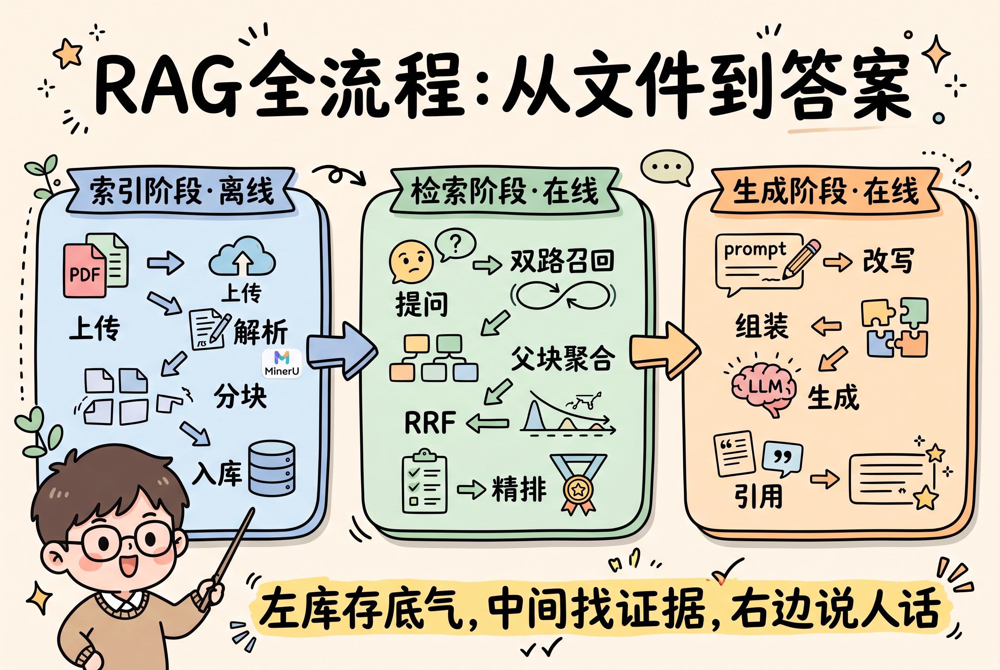
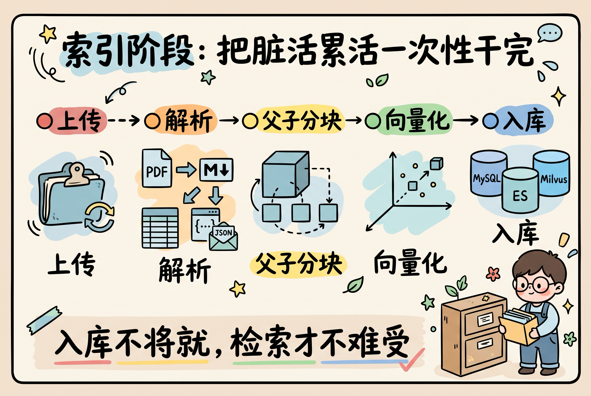

# 从文件到答案：RAG 全流程（分享版）

> 一句话：**左边把资料存好，中间把证据找齐，右边把答案说清楚。**
>
> 本文是分享向的总流程说明，不展开接口和表结构；索引阶段细节见[第一部分](./indexing/README.md)，检索阶段细节见[第二部分](./retrieval/README.md)。

| 项目 | 内容 |
| --- | --- |
| 文档编号 | RAG-E2E-000 |
| 文档版本 | V0.9（分享稿） |
| 编制 | 架构组 |
| 编制日期 | 2026-10-19 |
| 适用场景 | 团队内部分享、新人入门、方案宣讲 |

## 目录

1. [全流程总览](#1-全流程总览)
2. [第一部分：索引阶段（离线）](#2-第一部分索引阶段离线)
3. [第二部分：检索阶段（在线）](#3-第二部分检索阶段在线)
4. [第三部分：生成阶段（在线，重点查询改写）](#4-第三部分生成阶段在线重点查询改写)
5. [三个阶段在忙什么](#5-三个阶段在忙什么)
6. [五个常见误区](#6-五个常见误区)
7. [一句话收尾](#7-一句话收尾)
8. [图片生成提示词汇总](#8-图片生成提示词汇总)

---

## 1. 全流程总览



**文字版流程（图片生成前先看这个）**

```text
【索引·离线】上传 → 解析 → 父子分块 → 向量化 + 双写入库
【检索·在线】提问 → 查询向量化 → 向量库 + 关键词库 双路召回 → 父块聚合 → RRF 融合 → 精排
【生成·在线】查询改写 → 组装上下文 → 大模型生成 → 引用校验 → 带出处的答案
```

**图片生成提示词（GPT-image2.5）** — 复制以下整段：

```text
中文手绘风信息图，手账涂鸦 + 扁平插画风格，厚圆角描边，柔和马卡龙色块，浅米色纸张背景，粗体手写风中文标题，圆润可爱的扁平图标，卡通讲师小人拿教鞭，箭头连接流程，排版干净、俏皮、有分享感，适合技术分享配图。全部文字使用简体中文，字号大、无错别字，画面不要密集小字。图片比例 3:2 横版。不要写实照片、不要 3D、不要复杂背景、不要英文水印、不要乱码文字。

画面标题（顶部大字）：RAG 全流程：从文件到答案

构图：横向三栏圆角面板，粗箭头从左到右连接：
1）左侧面板（蓝色系），标题「索引阶段 · 离线」：文档图标 → 分片上传 → MinerU 解析 → 父子分块 → 三个数据库图标并列（MySQL 源数据 / ES 关键词 / Milvus 向量）。节点文字：上传、解析、分块、入库。
2）中间面板（绿色系），标题「检索阶段 · 在线」：问号气泡 → 查询向量化 → 两条并行路线（Milvus 向量库 / ES 关键词库）→ 按父块聚合 → RRF 融合 → 精排。节点文字：提问、双路召回、父块聚合、RRF、精排。
3）右侧面板（橙色系），标题「生成阶段 · 在线」：查询改写 → 组装 Prompt → 大模型 → 带引用的答案。节点文字：改写、组装、生成、引用。

卡通讲师小人站在左下角，用教鞭指向全图，表情自信。

底部标语横幅：粗体手写马克笔中文大字「规矩立住了，才能不烧心」。
```

> 备选标语：
> - 左库存底气，中间找证据，右边说人话
> - 先存明白，再找清楚，最后说明白
> - 索引是规矩，检索是本事，生成是表达

### 1.1 三个阶段的定位

| 阶段 | 什么时候跑 | 一句话目标 | 典型耗时 |
| --- | --- | --- | --- |
| 索引 | 文档上传后（离线） | 把知识存得全、切得准、找得到 | 秒级到分钟级 |
| 检索 | 每次提问（在线） | 把最相关的证据找回来、排好序 | 百毫秒级 |
| 生成 | 每次提问（在线） | 把证据组织成有出处、能落地的答案 | 秒级 |

---

## 2. 第一部分：索引阶段（离线）

> 索引阶段是"后厨"。用户看不见，但它决定了这顿饭好不好吃。



**文字版流程：**

```text
上传（大文件分片、断点续传）
  → 解析（PDF 走 MinerU 转 Markdown，Excel/CSV 转 JSON）
  → 父子分块（父块留完整语义，子块做向量和召回）
  → 向量化（阿里云 text-embedding-v4，默认 1024 维）
  → 双写入库（MySQL 存源数据，ES 存关键词，Milvus 存向量）
  → 文档 READY，可以检索
```

**这一阶段做了什么：**

- **上传**：单文件上限约 300MB，后端分片上传，刷新页面后重新选同一文件还能续传；
- **解析**：PDF 交给自建 MinerU 转 Markdown；Excel/CSV 不走 MinerU，直接解析成 JSON 再投影成文本；
- **父子分块**：父块 1200-2000 token，保证一段话完整；子块 300-500 token，专门用来做向量和关键词召回；
- **向量化 + 双写**：只给子块生成向量；MySQL 是唯一源数据，ES 和 Milvus 都是可以从零重建的派生索引；
- **状态管理**：文档走 `UPLOADED → PARSING → CHUNKING → INDEXING → READY`，只有 `READY` 才会被检索到。

**图片生成提示词（GPT-image2.5）：**

```text
中文手绘风信息图，手账涂鸦 + 扁平插画风格，厚圆角描边，柔和马卡龙色块，浅米色纸张背景，粗体手写风中文标题，圆润可爱的扁平图标，箭头连接，排版干净、俏皮、有分享感。全部文字使用简体中文，字号大、无错别字。图片比例 3:2 横版。不要写实照片、不要 3D、不要复杂背景、不要英文水印、不要乱码文字。

画面标题（顶部大字）：索引阶段：把脏活累活一次性干完

流程（横向 5 个圆角节点，粗箭头连接，蓝色系配色）：
1）上传：文件夹拖入 + 断点续传循环箭头，节点文字「上传」；
2）解析：PDF 变成 Markdown 纸张，表格变成 JSON，节点文字「解析」；
3）父子分块：一个大方块里面套三个小方块，节点文字「父子分块」；
4）向量化：小方块飞向一个向量坐标轴，节点文字「向量化」；
5）双写入库：三个数据库圆柱图标并排，节点文字「MySQL」「ES」「Milvus」。
右下角画一个卡通库管员小人，抱着文件往柜子里放，表情认真。

底部标语横幅：粗体手写马克笔中文大字「入库不将就，检索才不难受」。
```

> 备选标语：
> - 今天把脏活干完，明天才敢回答
> - 存得踏实，找得从容
> - 分块有规矩，召回有底气

---

## 3. 第二部分：检索阶段（在线）

> 检索阶段是"找证据"。找得准，生成才有底气；找不准，模型只能编。


**文字版流程：**

```text
用户提问
  → 查询向量化
  → 两条路并行：
       向量路：Milvus 找子块 Top 50
       关键词路：ES BM25 找子块 Top 50
  → 按父块聚合（同一个父块的多个子块只算一个结果）
  → 父块级 RRF 融合（k=60）
  → 可选 rerank 精排
  → 返回 Top 10 父块 + 命中子块片段
```

**这一阶段的关键点：**

- **两路召回**：向量擅长"语义相近"，关键词擅长"专有名词、编号、表格数字"，缺一不可；
- **父块聚合**：检索单位是子块，但返回单位是父块，避免把一句话切成几段喂给模型；
- **父块级 RRF**：每路先按最佳子块排名折叠成父块排名，再做 RRF，避免"子块多就赢"的数量优势；
- **降级可控**：ES 或 Milvus 挂了一路，另一路还能顶；两路都挂才返回 503；
- **rerank 是加分项**：默认关闭，开启后只对 Top 20 父块精排，失败就回退 RRF 顺序。

**图片生成提示词（GPT-image2.5）：**

```text
中文手绘风信息图，手账涂鸦 + 扁平插画风格，厚圆角描边，柔和马卡龙色块，浅米色纸张背景，粗体手写风中文标题，圆润可爱的扁平图标，箭头连接，排版干净、俏皮、有分享感。全部文字使用简体中文，字号大、无错别字。图片比例 3:2 横版。不要写实照片、不要 3D、不要复杂背景、不要英文水印、不要乱码文字。

画面标题（顶部大字）：检索阶段：两路一起找，证据来碰头

流程（绿色系配色）：
1）左侧：卡通用户举着对话气泡提问，气泡里写「收入结构？」，节点文字「提问」；
2）查询向量化：一个放大镜把文字变成数字坐标，节点文字「查询向量化」；
3）中间分成上下两条并行跑道，粗箭头指向右侧：
   上跑道：数据库圆柱图标 + 坐标轴，节点文字「Milvus 子块 Top 50」；
   下跑道：文档 + 放大镜图标，节点文字「ES 子块 Top 50」；
4）两条跑道汇入一个漏斗，漏斗里小方块合并成大方块，节点文字「父块聚合」；
5）漏斗后面接两个节点：「RRF 融合」和虚线框的「精排（可选）」；
6）最右侧输出一摞卡片，节点文字「Top 10 父块 + 命中片段」。
右下角卡通小人拿放大镜，表情专注。

底部标语横幅：粗体手写马克笔中文大字「不靠单路逞强，靠证据碰头」。
```

> 备选标语：
> - 广撒网，按父归，稳排序
> - 向量懂语义，关键词认死理，两个都要
> - 找得稳，答得准

---

## 4. 第三部分：生成阶段（在线，重点查询改写）

> 生成阶段是"表达"。但在开口之前，先得听懂问题——这就是查询改写。


**文字版流程：**

```text
用户问题（可能口语、多轮、带指代）
  → 查询改写（指代消解 / 口语变关键词 / 复杂问题拆解）
  → 调用检索，拿回父块证据
  → 组装 Prompt（系统约束 + 父块上下文 + 引用格式）
  → 大模型生成
  → 引用校验（chunk_id → 文件名 + 页码）
  → 带引用的答案，或明确说"没找到依据"
```

**为什么查询改写这么重要：**

| 场景 | 用户原话 | 改写后 |
| --- | --- | --- |
| 多轮指代 | "那它呢？" | "2026 年华东区收入结构是什么？" |
| 口语表达 | "帮我看看那个卖得咋样" | "销售数据、销量趋势、区域对比" |
| 复杂问题 | "华东和华南的收入差多少，为什么" | 拆成"华东收入"、"华南收入"、"差异原因"三个子问题 |
| 上下文补全 | "去年呢？" | "2025 年收入结构是什么？" |

**三条底线：**

- **可回退**：改写失败或超时，直接用原始问题去检索，不能让主链路挂掉；
- **可追溯**：改写后的 query 要记录进日志，方便解释"为什么答非所问"；
- **不编造**：模型只能基于检索到的父块回答，没有依据就明确说没有，不许硬编。

**图片生成提示词（GPT-image2.5）：**

```text
中文手绘风信息图，手账涂鸦 + 扁平插画风格，厚圆角描边，柔和马卡龙色块，浅米色纸张背景，粗体手写风中文标题，圆润可爱的扁平图标，箭头连接，排版干净、俏皮、有分享感。全部文字使用简体中文，字号大、无错别字。图片比例 3:2 横版。不要写实照片、不要 3D、不要复杂背景、不要英文水印、不要乱码文字。

画面标题（顶部大字）：生成阶段：先听懂问题，再翻书作答

流程（横向，橙色系配色，共 6 个节点，粗箭头连接）：
1）第一个节点：卡通用户说口语化的话，气泡里写「那它呢？」，节点文字「用户问题」；
2）查询改写节点：一支魔法笔把问号变成三个关键词卡片，节点文字「查询改写」，下方画三个小标签：「指代消解」「口语变关键词」「问题拆解」；
3）检索节点：一摞文件夹被吸进放大镜，节点文字「检索证据」；
4）组装节点：把几张卡片装进一个 Prompt 信封，节点文字「组装上下文」；
5）大模型节点：一个可爱的机器人脑袋，节点文字「大模型生成」；
6）最后一个节点：答案纸张右下角贴着引用标签，节点文字「带引用回答」，旁边画一个绿色对勾和一个灰色「无依据拒答」小标签。
右下角卡通小人举着"有出处"的印章。

底部标语横幅：粗体手写马克笔中文大字「没有出处的答案，一句也不要」。
```

> 备选标语：
> - 先听懂问题，再翻书作答
> - 改对了问题，就答对了一半
> - 答案可以慢，出处不能丢

---

## 5. 三个阶段在忙什么

| 维度 | 索引阶段 | 检索阶段 | 生成阶段 |
| --- | --- | --- | --- |
| 运行时机 | 文档上传后，离线 | 每次提问，在线 | 每次提问，在线 |
| 核心目标 | 存得全、切得准 | 找得回、排得稳 | 答得对、有出处 |
| 关键动作 | 解析、父子分块、向量化、双写 | 双路召回、父块聚合、RRF、rerank | 改写、组装、生成、引用校验 |
| 主要产物 | MySQL / ES / Milvus 索引 | Top 10 父块 + 命中片段 | 带引用的答案 |
| 失败影响 | 文档不可检索 | 结果变少或降级 | 答非所问、产生幻觉 |
| 主要成本 | 解析 + embedding（一次性） | 查询 embedding + 检索（每次） | 大模型 token（每次） |
| 调优顺序 | 先保证解析和分块质量 | 再保证召回和排序质量 | 最后调生成风格和格式 |

一句话记忆：

```text
索引是把书整理好，检索是把书翻到那一页，生成是把那一页讲成人话。
```

---

## 6. 五个常见误区

1. **只做向量，不做关键词**：专有名词、编号、表格里的数字，BM25 往往比向量更靠谱；
2. **只切小块，不留父块**：小块向量准了，但语义碎了，模型拿到上下文还是答不好；
3. **检索和生成一起调**：先看召回有没有把正确证据找回来，再谈生成质量；召回不行，换模型也白搭；
4. **查询改写没有兜底**：改写错了比不改还糟，必须保留原始问题作为回退；
5. **答案没有引用**：无法定位对错，出了问题只能猜；每条结论都应该能指回文件名和页码。

---

## 7. 一句话收尾

```text
索引是规矩，检索是本事，生成是表达。
规矩立住了，才能不烧心。
```

---

## 8. 图片生成提示词汇总

### 8.1 使用说明

1. GPT-image2.5 生成图片时，先贴"画面标题 + 流程 + 底部标语"那一段；
2. 每条提示词已经包含统一的风格描述，不需要额外再加风格词；
3. 中文文字是手绘风格的难点，建议：
   - 提示词里只保留短关键词（2-6 个字）；
   - 生成后如果个别字出错，用 Canva / Figma / PPT 覆盖打字修正；
4. 推荐尺寸：横版 `1536 x 1024`；
5. 想要人物一致，每条提示词里都保留"卡通讲师小人"或"卡通小人"这句话。

### 8.2 图片清单

| 图片文件 | 用途 | 底部标语 | 建议尺寸 |
| --- | --- | --- | --- |
| `./assets/end-to-end/00-end-to-end.png` | 全流程总览（左索引 / 中检索 / 右生成） | 规矩立住了，才能不烧心 | 1536 x 1024 |
| `./assets/end-to-end/01-indexing.png` | 索引阶段流程 | 入库不将就，检索才不难受 | 1536 x 1024 |
| `./assets/end-to-end/02-retrieval.png` | 检索阶段流程 | 不靠单路逞强，靠证据碰头 | 1536 x 1024 |
| `./assets/end-to-end/03-generation.png` | 生成阶段流程（含查询改写） | 没有出处的答案，一句也不要 | 1536 x 1024 |

### 8.3 通用负面提示词

```text
不要写实照片，不要 3D 渲染，不要复杂背景，不要英文水印，不要乱码文字，
不要密集小字，不要超过 7 个主要节点，不要人物手指变形，不要低分辨率。
```

### 8.4 备用标语池

| 阶段 | 标语 |
| --- | --- |
| 全流程 | 左库存底气，中间找证据，右边说人话 |
| 全流程 | 先存明白，再找清楚，最后说明白 |
| 索引 | 今天把脏活干完，明天才敢回答 |
| 索引 | 分块有规矩，召回有底气 |
| 检索 | 向量懂语义，关键词认死理，两个都要 |
| 检索 | 广撒网，按父归，稳排序 |
| 生成 | 改对了问题，就答对了一半 |
| 生成 | 答案可以慢，出处不能丢 |
| 收尾 | 规矩立住了，才能不烧心 |

---

## 附：维护说明

- 本文只做流程级分享，不替代第一、第二部分的详细设计；
- 技术方案变更时，只需同步更新"文字版流程"和图片提示词，不需要同步表结构和接口；
- 图片生成后放到 `docs/design/assets/end-to-end/` 对应文件名即可自动显示。
