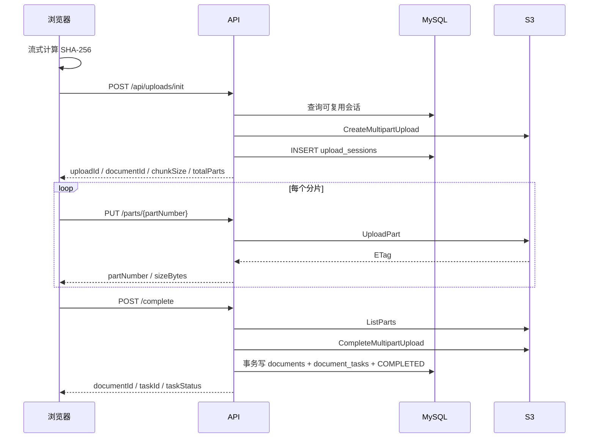
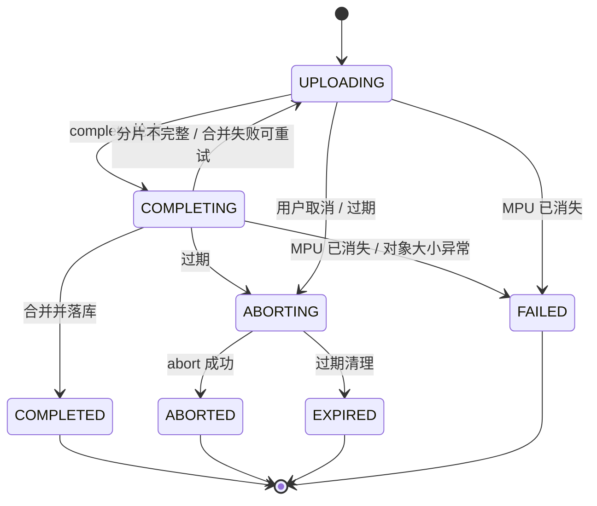
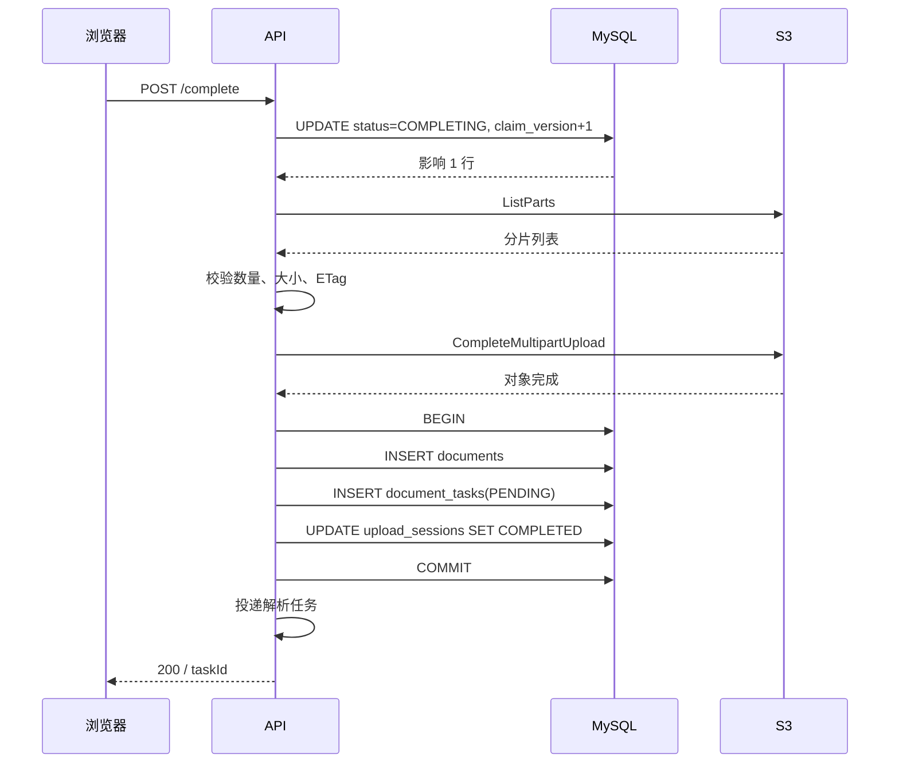

# 大文件上传实现说明

| 项目 | 内容 |
| --- | --- |
| 文档编号 | RAG-UPLOAD-IMPL |
| 文档版本 | V1.0 |
| 文档状态 | 实现基线 |
| 编制日期 | 2026-10-21 |
| 适用范围 | 浏览器分片上传、API 代理写 S3、上传会话、合并落库、合并异常恢复 |

## 1. 背景

文档入库需要支持最大 1000MiB 的单个文件。原上传链路把整个文件读入内存，再写本地临时文件，最后一次性写入对象存储。文件达到 1GB 时，这条链路会带来三个问题：

- API 进程需要同时持有完整文件，内存不可控；
- 上传没有真实进度，前端只能显示“请求中”；
- 网络中断后只能整文件重传，无法断点续传。

新链路采用浏览器分片、API 代理、S3 Multipart Upload：

```text
浏览器
  ├─ 流式计算全文件 SHA-256
  ├─ POST /api/uploads/init
  ├─ PUT  /api/uploads/{uploadId}/parts/{partNumber}  × N
  └─ POST /api/uploads/{uploadId}/complete
          │
          ▼
        API
          ├─ MySQL：upload_sessions / documents / document_tasks
          └─ S3：CreateMultipartUpload / UploadPart / ListParts / CompleteMultipartUpload
```

核心约束：

| 项目 | 取值 |
| --- | --- |
| 单文件上限 | 1000MiB |
| 分片大小 | 8MiB |
| 分片总数上限 | 10000 |
| 同时上传文件数 | 每浏览器 1 个 |
| 单文件并发分片数 | 2 |
| 上传会话有效期 | 24 小时 |
| 全文件指纹 | SHA-256，64 位小写十六进制 |
| 对象 key | `documents/{documentId}/source/{filename}` |
| 对象存储访问方式 | 仅 API 访问，浏览器不接触 S3 凭证 |

分片上传只负责把文件写入对象存储并生成文档记录和待处理任务。文档解析、分块和索引由后续阶段处理。

## 2. 分片上传

### 2.1 总体流程



### 2.2 为什么由 API 代理分片

浏览器不直接访问 S3，分片先进入 API，再由 API 写入 S3。这样做的目的：

- S3 凭证不进入浏览器；
- API 可以在写 S3 前完成会话状态、分片编号、Content-Length 和大小校验；
- 浏览器只需要和同源 API 通信，不需要处理 S3 签名、CORS 和预签名 URL 过期；
- 上传会话、文档 ID 和对象 key 的生成集中在服务端。

代价是 API 需要缓冲一个分片。按 8MiB 分片、2 个并发分片计算，单个上传请求占用的缓冲上限约为 16MiB；按 10 个并发用户估算，需要预留约 160MiB 分片缓冲，再加 boto3、请求解析和其他开销。

### 2.3 数据模型

上传会话表 `upload_sessions` 的关键字段：

| 字段 | 说明 |
| --- | --- |
| `id` | 上传会话 ID，即 `uploadId` |
| `document_id` | 预生成的文档 ID，与 `documents.id` 对应 |
| `fingerprint` | 全文件 SHA-256 |
| `active_fingerprint` | 生成列；状态为 `UPLOADING/COMPLETING` 时等于 `fingerprint`，否则为 `NULL` |
| `filename` | 规范化后的文件名 |
| `file_type` | 扩展名 |
| `size_bytes` | 文件总字节数 |
| `chunk_size` | 分片大小 |
| `total_parts` | 分片总数 |
| `object_key` | S3 对象 key |
| `s3_upload_id` | S3 Multipart Upload ID |
| `status` | 会话状态 |
| `abort_reason` | `USER` 或 `EXPIRED` |
| `claim_version` | 合并接管的 fencing 版本 |
| `expires_at` | 会话过期时间 |
| `completed_at` | 完成时间 |

`active_fingerprint` 上建立唯一索引，保证同一个指纹同时只有一个活跃会话。`document_id` 也建立唯一索引，保证一次上传只对应一个文档 ID。

文档表 `documents` 保存最终元数据：文件 ID、名称、类型、大小、对象 key、访问地址、预览信息和状态。

任务表 `document_tasks` 保存解析任务：

| 字段 | 说明 |
| --- | --- |
| `id` | 任务 ID，即 `taskId` |
| `document_id` | 文档 ID |
| `version` | 解析版本，首次为 1 |
| `status` | `PENDING/RUNNING/COMPLETED/FAILED` |
| `stage` | `PENDING/SPLITTING/PARSING/MERGING/CHUNKING/INDEXING/DONE` |
| `progress` | 0-100 |
| `step` | 当前步骤 |
| `error_message` | 失败原因 |
| `result_json` | 阶段检查点和结果 |

`(document_id, version)` 唯一，重复完成不会产生两条同版本任务。

### 2.4 会话状态



状态含义：

| 状态 | 含义 |
| --- | --- |
| `UPLOADING` | 可接收分片 |
| `COMPLETING` | 已抢占合并，正在校验、合并或写库 |
| `COMPLETED` | 合并成功，文档和任务已落库 |
| `ABORTING` | 正在取消 Multipart Upload |
| `ABORTED` | 用户取消完成 |
| `EXPIRED` | 会话过期，MPU 已取消 |
| `FAILED` | 合并或上传遇到不可恢复错误 |

### 2.5 断点续传与幂等

断点续传依赖三部分：

1. 浏览器计算全文件 SHA-256；
2. 服务端用 `active_fingerprint` 找到同一个活跃会话；
3. 以 S3 `ListParts` 的结果作为已上传分片的唯一依据，而不是在 MySQL 中逐片记录。

`init` 命中已有会话时会重新查询 `ListParts`，返回 `uploadedParts`。浏览器只补传缺失分片。

分片重复上传是幂等的：同一个 `partNumber` 再次 `UploadPart` 会覆盖 S3 中的旧分片，不会产生重复数据。`complete` 重复调用也不会重复创建文档。

## 3. init：创建或复用上传会话

### 3.1 接口

```http
POST /api/uploads/init
Content-Type: application/json
```

请求：

```json
{
  "filename": "年度报告.pdf",
  "sizeBytes": 104857600,
  "fingerprint": "3f2c...64位小写十六进制"
}
```

响应：

```json
{
  "uploadId": "8f1c...",
  "documentId": "a92d...",
  "status": "UPLOADING",
  "chunkSize": 8388608,
  "totalParts": 13,
  "uploadedParts": [],
  "expiresAt": "2026-10-22T13:30:00Z",
  "taskId": null,
  "taskStatus": null
}
```

`uploadedParts` 中的元素为：

```json
{
  "partNumber": 1,
  "sizeBytes": 8388608
}
```

HTTP 状态码：

| 状态码 | 场景 |
| --- | --- |
| `201` | 新建上传会话 |
| `200` | 复用 `UPLOADING` 会话，或返回已完成文档 |
| `202` | 会话处于 `COMPLETING/ABORTING` |
| `409` | 同一指纹存在元数据不一致的活跃会话 |
| `413` | 文件超过上限 |
| `415` | 扩展名不支持 |
| `422` | 文件名、大小、指纹或分片数不合法 |

### 3.2 参数校验

服务端在写数据库和 S3 前完成以下校验：

| 校验项 | 规则 |
| --- | --- |
| 文件名 | 规范化后不能为空、不能包含路径穿越、UTF-8 object key 不超过 1024 字节 |
| 扩展名 | 必须在允许列表中 |
| `fingerprint` | 64 位小写十六进制 |
| `sizeBytes` | 大于 0，且不超过 1000MiB |
| `totalParts` | `ceil(sizeBytes / chunkSize)`，不超过 10000 |

服务端不接受客户端传入的 `chunkSize` 和 `totalParts`，统一使用服务端配置计算，避免客户端伪造分片边界。

### 3.3 复用顺序

`init` 按以下顺序查找：

```text
1. 未过期的 UPLOADING 会话
2. COMPLETING 会话
3. 文档仍存在的 COMPLETED 会话
4. ABORTING 会话
5. 过期的 UPLOADING 会话（取消后新建）
6. 没有可复用会话（新建）
```

#### 未过期的 UPLOADING

- 文件名和大小一致：调用 S3 `ListParts`，续期 `expires_at`，返回 `200`；
- 文件名或大小不一致：返回 `409 FINGERPRINT_CONFLICT`；
- `ListParts` 发现 MPU 已不存在：会话标 `FAILED`，继续走新建流程。

#### COMPLETING

直接返回 `202`，并尽量带回 `ListParts`。客户端继续轮询 `GET /api/uploads/{uploadId}`。

#### COMPLETED

如果 `documents` 中对应文档仍存在，返回 `200`，并带回最新的 `taskId/taskStatus`。文档已被删除时，不复用这条会话，创建新会话。

#### ABORTING

返回 `202`。客户端继续轮询，等待清理任务把状态推进到 `ABORTED/EXPIRED`。

#### 过期的 UPLOADING

条件更新为 `ABORTING(EXPIRED)`，取消失败也不阻塞新建；随后创建新会话。

### 3.4 新建会话

新建流程：

1. 生成 `documentId` 和 `uploadId`；
2. 生成对象 key `documents/{documentId}/source/{filename}`；
3. 调用 S3 `CreateMultipartUpload`；
4. 写入 `upload_sessions`；
5. 返回 `201`。

`CreateMultipartUpload` 只创建上传占位符，不写入文件内容。S3 中不会出现完整对象，直到 `complete` 调用 `CompleteMultipartUpload`。

### 3.5 并发初始化

两个请求可能同时对同一个指纹执行 `init`：

```text
请求 A：CreateMultipartUpload → INSERT 成功
请求 B：CreateMultipartUpload → INSERT 遇到唯一键冲突
```

请求 B 的处理：

1. 捕获 `active_fingerprint` 唯一键冲突；
2. 取消自己刚创建的 MPU；
3. 重新查询活跃会话；
4. 元数据一致则返回已有会话，否则返回 `409`。

这样不会出现两个浏览器分别持有一个 MPU、最终只有一个能完成的情况。

### 3.6 续期

复用 `UPLOADING` 会话时，`expires_at` 更新为 `now + 24h`，`updated_at` 同步更新。上传期间长时间没有请求的会话最终会被清理任务置为过期。

## 4. 分片上传：写入单个分片

### 4.1 接口

```http
PUT /api/uploads/{uploadId}/parts/{partNumber}
Content-Length: 8388608
Content-Type: application/octet-stream

<8MiB 二进制>
```

响应：

```json
{
  "partNumber": 1,
  "sizeBytes": 8388608
}
```

### 4.2 服务端校验

分片接口按顺序执行：

| 校验 | 失败结果 |
| --- | --- |
| 会话存在 | `404 UPLOAD_NOT_FOUND` |
| 会话可接收分片 | 已完成/进行中/已取消/已过期/失败分别返回对应错误 |
| 会话未过期 | `410 UPLOAD_EXPIRED` |
| `partNumber` 在 `1..totalParts` | `422 INVALID_PART_NUMBER` |
| 存在 `Content-Length` | `411 LENGTH_REQUIRED` |
| 长度不超过预期分片大小 | `413 PART_TOO_LARGE` |
| 长度等于预期分片大小 | `422 INVALID_PART_SIZE` |
| 实际读取字节数等于预期 | `422 INVALID_PART_SIZE` |

预期大小计算：

```text
partNumber < totalParts  -> chunkSize
partNumber == totalParts -> sizeBytes - (totalParts - 1) * chunkSize
```

最后一片可以小于 `chunkSize`，其他分片必须正好等于 `chunkSize`。

### 4.3 写入 S3

校验通过后调用：

```text
UploadPart(
  Bucket=bucket,
  Key=object_key,
  UploadId=s3_upload_id,
  PartNumber=partNumber,
  Body=body
)
```

API 只缓冲当前分片，不在内存中拼接整个文件。分片写入成功返回该分片的 `partNumber` 和 `sizeBytes`。

服务端不把每个分片的 ETag 写入 MySQL。已上传分片以 S3 `ListParts` 为准，避免数据库和对象存储出现两份不一致的分片状态。

### 4.4 幂等与重试

- 同一个 `partNumber` 重复 `PUT`：S3 覆盖旧分片，结果幂等；
- 网络超时后客户端重试：只要会话仍在 `UPLOADING`，可以继续上传；
- 分片顺序不要求严格递增，S3 Multipart 允许乱序上传；
- `complete` 时会按 `partNumber` 排序，并使用 `ListParts` 返回的 ETag 合并。

### 4.5 状态查询

```http
GET /api/uploads/{uploadId}
```

返回当前会话、已上传分片和任务信息。客户端在以下场景使用：

- `complete` 返回 `202` 时轮询；
- 页面刷新后恢复上传；
- 上传中断后检查哪些分片已存在。

`GET` 对终态会话返回空 `uploadedParts`，对 `UPLOADING/COMPLETING` 会话返回 S3 `ListParts` 的结果。

## 5. 合并：完成上传

### 5.1 接口

```http
POST /api/uploads/{uploadId}/complete
```

响应：

```json
{
  "uploadId": "8f1c...",
  "documentId": "a92d...",
  "status": "COMPLETED",
  "taskId": "6b7e...",
  "taskStatus": "PENDING"
}
```

状态码：

| 状态码 | 场景 |
| --- | --- |
| `200` | 合并成功，或已完成 |
| `202` | 另一个请求正在合并 |
| `409` | 分片不完整、正在取消、已失败 |
| `410` | 已过期或已取消 |
| `503` | 合并结果暂时不确定，可重试 |

### 5.2 合并流程



### 5.3 抢占 COMPLETING

合并前先做条件更新：

```sql
UPDATE upload_sessions
SET status = 'COMPLETING',
    claim_version = claim_version + 1,
    updated_at = :now
WHERE id = :upload_id
  AND status = 'UPLOADING'
  AND expires_at > :now
```

只有影响 1 行的请求获得合并权。其他并发请求重新读取会话：

- `COMPLETED`：返回已有结果；
- `COMPLETING`：返回 `202`；
- `ABORTING/ABORTED/EXPIRED/FAILED`：返回对应错误。

`claim_version` 同时作为后续落库的条件，防止旧执行者覆盖新状态。

### 5.4 分片校验

通过 S3 `ListParts` 获取分片列表，再检查：

1. 编号 `1..totalParts` 是否全部存在；
2. 每片大小是否等于预期大小；
3. 最后一片是否等于剩余字节数。

缺片时：

```text
条件回退 COMPLETING -> UPLOADING
返回 409 UPLOAD_INCOMPLETE
details: { "missingParts": [2, 3] }
```

大小异常时返回：

```json
{
  "error": {
    "code": "UPLOAD_INCOMPLETE",
    "message": "分片大小不完整",
    "details": {
      "invalidParts": [2]
    }
  }
}
```

回退后用户可以补传缺失分片，再次调用 `complete`。

### 5.5 合并对象

校验通过后调用：

```text
CompleteMultipartUpload(
  Bucket=bucket,
  Key=object_key,
  UploadId=s3_upload_id,
  MultipartUpload={
    "Parts": [
      {"PartNumber": 1, "ETag": "\"...\""},
      ...
    ]
  }
)
```

分片按 `PartNumber` 升序提交。ETag 使用 `ListParts` 返回的原始值，不在服务端重新计算。

### 5.6 落库事务

S3 合并成功后，在同一个 MySQL 事务中执行：

1. 插入 `documents`；
2. 插入 `document_tasks`，`version=1`，状态 `PENDING`；
3. 更新 `upload_sessions`：

```sql
UPDATE upload_sessions
SET status = 'COMPLETED',
    completed_at = :now,
    updated_at = :now
WHERE id = :upload_id
  AND status = 'COMPLETING'
  AND claim_version = :claim_version
```

如果第 3 步影响 0 行，抛状态冲突并回滚整个事务，避免出现“文档已写入但会话仍不是 COMPLETED”的半完成状态。

### 5.7 任务投递

事务提交后，`complete` 调用任务投递：

```text
dispatch_task(task_id) -> parse_document.delay(task_id)
```

投递结果处理：

- 投递成功：返回 `200`，`taskStatus=PENDING`；
- 投递失败：记录日志，任务保持 `PENDING`，接口仍返回 `200`。

原因是文件已经完整写入 S3，数据库事务也已完成，不能因为 Redis 抖动让用户重新上传 1GB 文件。`PENDING` 任务会由补投任务重新投递。

### 5.8 幂等

重复调用 `complete`：

- 会话 `COMPLETED`：返回已有 `taskId/taskStatus`，不重复写文档；
- 会话 `COMPLETING`：返回 `202`，不重复合并；
- 会话 `UPLOADING`：重新抢占并执行。

S3 `CompleteMultipartUpload` 本身不是幂等操作，重复调用通常返回 `NoSuchUpload`。因此服务端必须依赖会话状态和 `claim_version` 阻止重复合并，而不是依赖 S3 的重复调用语义。

## 6. 合并异常处理

合并阶段涉及两个独立系统：S3 和 MySQL。任何一步失败都可能留下不一致状态，因此异常处理的核心原则是：

- 先判断 S3 是否其实已经成功；
- 能回退到 `UPLOADING` 的，回退让用户补传或重试；
- 不能回退的，保持 `COMPLETING`，交给恢复任务；
- 不可恢复的，明确标记 `FAILED`。

### 6.1 异常分类

| 异常 | 处理 |
| --- | --- |
| `UploadNotFound`（MPU 已不存在） | 会话标 `FAILED`，返回 `410 UPLOAD_EXPIRED` |
| `StorageError`，但 `HeadObject` 发现对象已存在且大小正确 | 视为合并成功，继续写文档和任务 |
| `StorageError`，对象不存在且会话未过期 | 回退 `UPLOADING`，返回 `503 STORAGE_UNAVAILABLE` |
| `StorageError`，对象不存在且会话已过期 | `COMPLETING -> ABORTING(EXPIRED)`，abort MPU，返回 `410` |
| `StorageError`，对象存在但大小不一致 | 会话标 `FAILED`，返回 `409 UPLOAD_FAILED` |
| `StorageError`，`HeadObject` 也不可用 | 保持 `COMPLETING`，返回 `503`，由恢复任务兜底 |
| MySQL 事务失败 | S3 对象已存在，会话保持 `COMPLETING`，由恢复任务补写数据库 |

### 6.2 为什么不能直接判定失败

`CompleteMultipartUpload` 超时并不代表 S3 没有完成合并。可能出现：

```text
API 发出 CompleteMultipartUpload
S3 已完成合并
网络在响应返回前中断
API 收到超时
```

此时如果直接把会话标 `FAILED`，S3 中其实已经有一个完整对象，数据库却没有 `documents` 行，形成孤儿对象。

因此超时后先执行：

```text
HeadObject(object_key)
```

再根据对象是否存在、大小是否正确决定后续动作。

### 6.3 对象已存在

```text
HeadObject 返回 size == size_bytes
```

说明 S3 已合并成功但响应丢失。服务端跳过再次合并，直接进入落库流程：

1. 写 `documents`；
2. 写 `document_tasks`；
3. 条件更新会话为 `COMPLETED`；
4. 投递任务。

如果对象大小不等于 `size_bytes`，说明对象内容异常，会话标 `FAILED`，由孤儿对象清理任务在保留期后删除。

### 6.4 对象不存在且未过期

```text
HeadObject 返回 None
session.expires_at > now
```

说明合并大概率没有成功，且会话仍可继续使用：

```text
条件回退 COMPLETING -> UPLOADING
返回 503 STORAGE_UNAVAILABLE
```

客户端可以：

- 重新调用 `complete`；
- 先调用 `GET` 检查分片；
- 补传缺失分片后再合并。

回退使用 `claim_version` 条件，避免覆盖其他执行者的状态。

### 6.5 对象不存在且已过期

如果会话已经过期：

```text
COMPLETING -> ABORTING(EXPIRED)
AbortMultipartUpload
ABORTING -> EXPIRED
```

返回 `410 UPLOAD_EXPIRED`。此时不再允许继续上传，S3 中残留的 MPU 由清理任务处理。

### 6.6 HeadObject 不可用

如果 `HeadObject` 也返回存储错误，服务端无法判断 S3 是否已经完成合并。此时：

- 不修改会话状态；
- 保持 `COMPLETING`；
- 返回 `503 STORAGE_UNAVAILABLE`；
- 由定时恢复任务在租约到期后再次尝试。

这是“宁可暂时不确定，也不误删或误判”的处理方式。

### 6.7 恢复 COMPLETING

恢复任务每 5 分钟扫描：

```sql
SELECT *
FROM upload_sessions
WHERE status = 'COMPLETING'
  AND updated_at < now() - lease
ORDER BY updated_at
LIMIT batch_size
```

默认租约为 300 秒。

恢复顺序：

```text
1. HeadObject(object_key)
   ├─ 对象存在且大小正确 -> 补写 documents/tasks，置 COMPLETED
   ├─ 对象存在但大小不对 -> 标记 FAILED
   └─ 对象不存在
        ├─ ListParts
        │   ├─ 分片齐全 -> CompleteMultipartUpload -> 补写 DB
        │   ├─ 缺片且未过期 -> 回退 UPLOADING
        │   └─ 缺片且已过期 -> ABORTING(EXPIRED) -> EXPIRED
        └─ NoSuchUpload -> 标记 FAILED
```

恢复流程和正常 `complete` 共用落库函数，写数据库时仍带 `claim_version` 条件，避免和原执行者双写。

### 6.8 清理任务

合并异常和上传会话最终由维护任务兜底：

| 任务 | 频率 | 作用 |
| --- | --- | --- |
| `recover_completing_uploads` | 每 5 分钟 | 恢复超时 `COMPLETING` |
| `expire_uploads` | 每小时 | 过期 `UPLOADING -> ABORTING(EXPIRED) -> EXPIRED` |
| `retry_aborting_uploads` | 每小时 | 重试超时 `ABORTING` |
| `cleanup_orphan_mpu` | 每天 | 取消没有会话或会话已终态的 MPU |
| `cleanup_orphan_object` | 每天 | 删除终态且没有 `documents` 行的孤儿对象 |
| `cleanup_old_sessions` | 每天 | 删除超过保留期的终态会话 |
| `redispatch_pending_tasks` | 每 5 分钟 | 重新投递超时 `PENDING` 任务 |

默认参数：

| 配置 | 默认值 |
| --- | --- |
| `UPLOAD_COMPLETE_LEASE_SECONDS` | 300 |
| `ORPHAN_MPU_GRACE_HOURS` | 24 |
| `ORPHAN_OBJECT_RETENTION_DAYS` | 7 |
| `SESSION_RETENTION_DAYS` | 30 |
| `CLEANUP_BATCH_SIZE` | 50 |

### 6.9 错误响应

统一错误结构：

```json
{
  "error": {
    "code": "UPLOAD_INCOMPLETE",
    "message": "还有分片未上传",
    "details": {
      "missingParts": [2, 3]
    }
  }
}
```

合并相关错误码：

| 错误码 | HTTP | 含义 |
| --- | --- | --- |
| `UPLOAD_NOT_FOUND` | 404 | 上传会话不存在 |
| `UPLOAD_ALREADY_COMPLETED` | 409 | 已完成，不能继续操作 |
| `UPLOAD_COMPLETING` | 409 | 正在合并 |
| `UPLOAD_ABORTING` | 409 | 正在取消 |
| `UPLOAD_ABORTED` | 410 | 已取消 |
| `UPLOAD_EXPIRED` | 410 | 已过期 |
| `UPLOAD_FAILED` | 409 | 已失败，需要重新上传 |
| `UPLOAD_INCOMPLETE` | 409 | 分片缺失或大小不正确 |
| `STORAGE_UNAVAILABLE` | 503 | 存储暂时不可用，可重试 |

### 6.10 验证场景

合并异常至少覆盖以下场景：

| 场景 | 预期 |
| --- | --- |
| 合并超时，但对象已存在且大小正确 | 继续落库，返回 `200` |
| 合并超时，对象不存在且未过期 | 回退 `UPLOADING`，返回 `503`，重试成功 |
| 合并超时，对象不存在且已过期 | 会话 `EXPIRED`，返回 `410` |
| MPU 已不存在 | 会话 `FAILED`，返回 `410` |
| 对象存在但大小不一致 | 会话 `FAILED`，返回 `409` |
| `HeadObject` 也不可用 | 保持 `COMPLETING`，恢复任务稍后处理 |
| 缺片 | 回退 `UPLOADING`，返回 `409 UPLOAD_INCOMPLETE` |
| 重复 `complete` | 第二次返回已有结果或 `202`，不重复写文档 |

## 7. 实现位置

| 模块 | 文件 |
| --- | --- |
| 上传接口 | `backend/api/uploads/router.py` |
| 请求/响应模型 | `backend/api/uploads/schemas.py` |
| 上传错误码 | `backend/api/uploads/errors.py` |
| 初始化会话 | `backend/services/upload/steps/session.py` |
| 分片上传 | `backend/services/upload/steps/part.py` |
| 状态查询 | `backend/services/upload/steps/status.py` |
| 合并与恢复 | `backend/services/upload/steps/completion.py` |
| 取消上传 | `backend/services/upload/steps/cancellation.py` |
| 公共辅助 | `backend/services/upload/shared.py` |
| 会话/任务 SQL | `backend/model/upload/orm.py`、`backend/model/document_task/orm.py` |
| S3 适配 | `backend/services/common/object_storage.py` |
| 清理与补投 | `backend/services/upload/jobs/`、`backend/task/maintenance.py` |
| 表结构 | `backend/db/schema.sql` |
