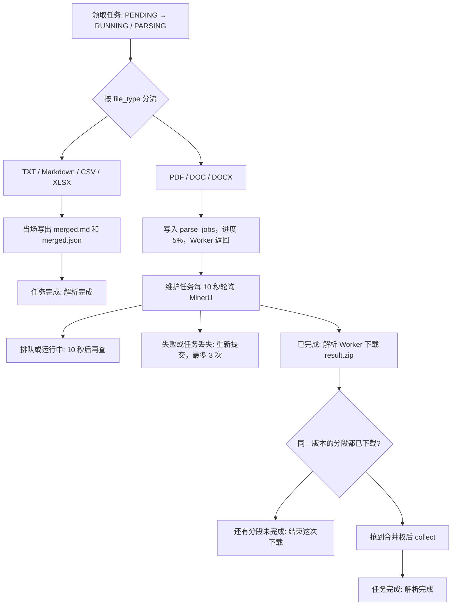

# 文件解析实现说明

| 项目 | 内容 |
| --- | --- |
| 文档编号 | RAG-PARSE-IMPL |
| 文档版本 | V1.0 |
| 文档状态 | 实现基线 |
| 编制日期 | 2026-10-23 |
| 适用范围 | 上传完成后的文档解析：按文件类型分流、PDF 拆分、MinerU 提交与轮询、结果合并、写入对象存储 |
| 代码基线 | `backend/services/parsing/`、`backend/task/parse_document.py`、`backend/task/poll_parse.py` |

本文记录当前已经落地的解析过程。评审稿仍是 [文档解析详细设计](./indexing/02-document-parsing.md)。两份文档不一致时，以本文和代码为准。上传阶段见 [大文件上传实现说明](./大文件上传实现说明.md)。

## 1. 范围

解析从 `document_tasks` 被解析 Worker 领取开始，到下面两件事结束：

- 解析产物写入对象存储；
- 该条任务变为 `COMPLETED`。

解析不把文档改成 `READY`，也不切块、不做向量、不写 Elasticsearch。文档在上传完成时是 `UPLOADED`，解析成功后状态保持不变，只补上 `parsed_md_key` 和 `parsed_json_key`。

允许进入解析的扩展名：

| 扩展名 | 处理位置 |
| --- | --- |
| `pdf` | 下载到磁盘，按页和大小拆分后提交 MinerU |
| `doc`、`docx` | 下载到磁盘，未超过单段上限时整份提交 MinerU |
| `md`、`markdown` | 进程内读取，原文保留 |
| `txt` | 进程内读取，按空行分段落 |
| `csv` | 进程内读取，转成 JSON 对象数组 |
| `xlsx` | 进程内读取，每个工作表转成 JSON 对象数组 |

`xls` 不在允许列表里。上传接口和前端选择框都不接收它。

## 2. 总流程

上传合并成功后会插入一条 `PENDING` 的 `document_tasks`，并投递 `rag.parse_document`。解析 Worker 监听默认队列 `celery`。



一次 `parse()` 只有两种结果：

| 结果 | 谁返回 | 随后做什么 |
| --- | --- | --- |
| `FinishedParse` | TXT、Markdown、CSV、XLSX | 立刻 `upload()`、`persist()`，任务完成 |
| `SubmittedParse` | PDF、DOC、DOCX | 每个分段插入一行 `parse_jobs`，任务保持 `RUNNING`，步骤写成「分段已提交」 |

`parse_document` 的软超时是 300 秒，硬超时是 330 秒。PDF 的下载、拆分和向 MinerU 提交都算在这一次里面。轮询、结果下载和合并是后面的独立任务，不占用这一次超时。

## 3. 各类文件怎么处理

分流在 `ParserRegistry`。扩展名对不上已注册的解析器时，任务和文档一起失败，原因是「没有注册文件类型」。

本地解析和 MinerU 解析最后都落到同一套对象键：

```text
documents/{documentId}/parsed/{version}/merged.md
documents/{documentId}/parsed/{version}/merged.json
documents/{documentId}/parsed/{version}/manifest.json
```

首次上传的任务 `version` 是 1。本地文件的 `merged.md` 不加 `<!-- page: N -->`。

### 3.1 Markdown

整份对象读入内存，按 UTF-8 解码，并去掉文件头 BOM。解码失败则任务失败，提示「Markdown 不是 UTF-8 文本」。

正文原样放进一个文本块，不改标题，不补空行，不插入文件名。`merged.md` 就是这块正文。`merged.json` 的形状是：

```json
{
  "type": "md",
  "title": "文件名去掉扩展名",
  "blocks": [
    {"kind": "text", "text": "原文"}
  ]
}
```

`markdown` 与 `md` 走同一个解析器。

### 3.2 TXT

整份对象读入内存。先按 UTF-8（含 BOM）解码，失败再按 GBK。两种都失败则提示「TXT 不是 UTF-8 或 GBK 文本」。

换行统一成 `\n`。空行作为段落边界，段首段尾空白去掉。输出时先放一行一级标题，标题是文件名去掉扩展名，后面每个段落一块。`merged.md` 用空行把这些块拼起来。

### 3.3 CSV

整份对象读入内存。编码顺序与 TXT 相同，失败提示「CSV 不是 UTF-8 或 GBK 文本」。

分隔符只在逗号、制表符、分号里选。看第一条非空行，引号外出现次数最多的那个胜出；三个都没出现时用逗号。

第一行非空记录是表头。每一条数据行变成一个 JSON 对象，键是表头：

| 单元格 | JSON 值 |
| --- | --- |
| 空白 | `null` |
| 整数 | 数字 |
| 小数 | 数字 |
| 其他文本 | 字符串 |

空表头、重复表头写成 `column_N`。数据行比表头更宽时补列，已经读过的行在新列上补 `null`。空行跳过。没有表头则失败。

上限：

| 项目 | 上限 |
| --- | --- |
| 数据行 | 200000 |
| 单元格 | 2000000 |

超过上限直接失败，不截断。整张表放在一个 `kind=table` 的块里，`text` 是 JSON 数组。因此 CSV 的 `merged.md` 也是这份 JSON 文本，不是叙述性 Markdown。整表只放在对象存储，不写入 MySQL。

### 3.4 XLSX

整份对象读入内存，用 openpyxl 以 `data_only=True` 打开。读到的是工作簿里已经缓存的值，公式不会在解析时重算。打不开、不是合法压缩包，都提示「XLSX 无法解析」。

打开前先看压缩包声明的解压体积，合计超过 2GiB 则拒绝，避免小文件解压成超大工作簿。

每个有表头的工作表单独成为一个 `kind=table` 的块，`sheet` 是工作表名，`text` 是 JSON 对象数组。没有表头的表跳过。所有表都没有表头时，提示「Excel 没有表头」。多个表的 `merged.md` 是这些 JSON 数组用空行拼在一起；`merged.json` 里仍按工作表分成多个块。

值的保留规则：

| 单元格 | JSON 值 |
| --- | --- |
| 空 | `null` |
| 布尔 | `true` / `false` |
| 日期时间 | `YYYY-MM-DDTHH:MM:SS` |
| 日期 | `YYYY-MM-DD` |
| 整数，以及小数点后为 0 的浮点 | 整数 |
| 其他有限浮点 | 数字 |
| 非有限浮点 | `null` |
| 文本 | 去掉首尾空白后的字符串 |

合并单元格的其余位置沿用左上角的值。空表头和重复表头同样写成 `column_N`。

上限：

| 项目 | 上限 |
| --- | --- |
| 工作表 | 50 |
| 单个工作表列数 | 256 |
| 单个工作表行数 | 200000，另加表头一行 |
| 全部单元格 | 2000000 |
| 声明的解压体积 | 2GiB |

### 3.5 PDF

PDF 先用对象存储的流式下载写到临时目录，不把整份源文件一次读进内存。再用 PyMuPDF 打开。导入名是 `pymupdf`。

打不开、页数为 0、文件大小为 0，都视为损坏。文件带用户密码，且空密码解不开，提示「PDF 已加密」。

未超过单段上限时，不复制文件，分段的 `source_key` 仍是上传时的原始对象键，页码从 1 到最后一页。超过上限则按第 4 节拆开。每一段单独提交 MinerU，并记下真实页码。`parse()` 在全部分段都提交后返回，不等待 MinerU 解析结束。

### 3.6 DOC 和 DOCX

Word 没有可以按页切开的结构，因此不做拆分。记录的文件大小已经超过 180MiB 时，连下载都不做，直接失败。否则流式下载到临时目录，再按实际文件大小判断一次。仍超过 180MiB 则失败，提示「Word 超过 180MiB，不能直接提交」。

未超过上限时整份提交。分段只有一个：`part_index=1`，`page_start=1`，`page_end=0`。`page_end` 为 0 表示页数还没有测量。`source_key` 是原始对象键，供以后重新提交。

DOC 和 DOCX 共用这条路径。中间不转 PDF，也不调用 LibreOffice。

## 4. 大文件

上传阶段已经把单文件限制在 1000MiB。解析阶段再按下游能力加第二层限制。

| 路径 | 大文件怎么处理 |
| --- | --- |
| PDF | 流式下到磁盘。超过 180 页或 180MiB 就按页拆开，每段再提交 |
| DOC、DOCX | 超过 180MiB 失败，不拆分 |
| CSV、XLSX | 整份读入内存，再用行数、列数、单元格数和解压体积挡住 |
| TXT、Markdown | 整份读入内存，没有单独的拆分 |

180MiB 的字节数是 `180 * 1024 * 1024`，即 188743680。

### 4.1 PDF 怎么拆

只在页数和文件大小都没有超过上限时保留原文件。否则：

1. 只有一页，但文件已经超过 180MiB：失败，提示「PDF 单页超过 180MiB，请压缩或拆分源文件」。
2. 用平均页大小估算一段能放多少页：

```text
pages_per_part = max(1, min(180, (180MiB * 总页数) / 文件字节数, 总页数))
```

3. 按这个页数把文档切成互不重叠的页区间，用 PyMuPDF 写成新的 PDF。页码从 1 开始，结束页包含在内。
4. 某一段写出来仍超过 180MiB：删掉该文件，页数减半再切。减到一页仍超过，同样按单页超限失败。
5. 每一段按 1MiB 分块计算 SHA-256。

拆出来的 PDF 会先写入对象存储，再交给 MinerU。键是：

```text
documents/{documentId}/parse/{version}/parts/{partIndex}/source.pdf
```

提交给 MinerU 的文件名是 `{原文件名}-part-{序号}.pdf`。这样轮询失败后可以按 `source_key` 重新提交，不必再拆一次源文件。

一段在写入对象存储和提交 MinerU 时会读入内存。拆分保证这一段不超过 180MiB。源文件本身只通过流式下载落盘。

页与页之间没有重叠。设计稿里的 `PARSE_PAGE_OVERLAP` 没有实现。

### 4.2 表格为什么不按大小切

CSV 和 XLSX 的产物是「表头为键」的 JSON 数组，按字节切开会把一行或一个工作表切坏。当前用行数、列数和单元格数拒绝过大的表。超过上限的文件需要先在源文件里拆开再上传。解析器不会把大表写成 JSONL，也不会分批上传。

## 5. MinerU

MinerU 客户端只负责提交、查询和下载。文件大小是否允许，由 PDF 和 Word 解析器在调用前决定。

地址和密钥来自环境变量 `MINERU_API_URL`、`MINERU_API_KEY`，不要求进程启动时就存在。真正发起调用时地址仍为空，才失败，提示「MINERU_API_URL 未配置」。密钥非空时放在 `Authorization: Bearer` 里。日志不记录密钥。

生产客户端使用标准库 `urllib`。下面的路径是按调用顺序约定的，仓库里没有一份已经抓到的服务端说明。服务端路径不同时，只改 `backend/services/parsing/mineru/client.py` 顶部的常量。

| 调用 | 方法与路径 | 成功时使用的字段 |
| --- | --- | --- |
| 上传文件 | `POST /v1/files` | `file_id` |
| 提交任务 | `POST /v1/jobs`，JSON 体 `{"file_id": "..."}` | `job_id` |
| 查询状态 | `GET /v1/jobs/{job_id}` | `status`，失败时还有 `error` |
| 下载结果 | `GET /v1/jobs/{job_id}/result` | 响应体是 zip |

上传是 multipart，字段为 `file`、`filename`、`sha256`。状态只接受 `queued`、`running`、`completed`、`failed`。

客户端自己的重试：

| 情况 | 处理 |
| --- | --- |
| 408、429、500、502、503、504，以及连接失败 | 最多 3 次，间隔 1 秒、2 秒。耗尽后是 `ParserUnavailable` |
| 查询或下载返回 404 | `MinerUJobLost`，表示任务索引已经丢了 |
| 其他 4xx | `MinerURequestError`，不重试 |
| 查询超时 | 60 秒 |
| 上传和下载超时 | 300 秒 |

`job_id` 里如果包含 `/`、`\`、空字节、`.` 或 `..`，请求不会发出。

提交成功后，`parse_document` 为每个分段插入一行：

| 字段 | 取值 |
| --- | --- |
| `status` | `SUBMITTED` |
| `attempts` | 1 |
| `next_poll_at` | 当前时间加 10 秒 |
| `mineru_file_id`、`mineru_job_id` | 本次提交返回的编号 |
| `page_start`、`page_end` | PDF 为真实页码；Word 的 `page_end` 为 0 |
| `source_key` | 未拆分的原始对象键，或拆分后的 `source.pdf` |
| `result_key` | 空 |

文档任务此时仍是 `RUNNING` / `PARSING`，进度 5，步骤「分段已提交」。

## 6. 轮询、下载和合并

### 6.1 三个进程

| 进程 | 队列 | 任务 |
| --- | --- | --- |
| 定时 | 只负责发消息 | 每 10 秒投递 `rag.poll_parse_jobs` |
| 维护 | `maintenance` | 执行轮询。一次最多领 50 个分段 |
| 解析 | `celery` | 执行 `rag.download_parse_result` 和 `rag.resubmit_parse_part`。软超时 300 秒，硬超时 330 秒 |

轮询只问状态，不在持有数据库锁时下载 zip。下载和重新提交放到解析 Worker，避免维护进程被大文件堵住。

进程需要重启后，新的任务名才会注册。

### 6.2 领取

轮询在一个事务里执行：

```sql
SELECT * FROM parse_jobs
WHERE next_poll_at IS NOT NULL
  AND next_poll_at <= 当前时间
  AND (
    status IN ('SUBMITTED', 'RUNNING')
    OR (status = 'DOWNLOADING' AND result_key IS NULL)
  )
ORDER BY next_poll_at
LIMIT 50
FOR UPDATE SKIP LOCKED
```

领走之后立刻把 `next_poll_at` 往后推，再提交事务。普通查询推 10 秒，已经处于下载中的分段推 300 秒。这样下一次定时任务不会把同一行再领走。

### 6.3 状态对应的动作

| MinerU 状态或异常 | 分段怎么变 | 随后 |
| --- | --- | --- |
| `queued` | 保持 `SUBMITTED`，10 秒后再查 | 无 |
| `running` | 改为 `RUNNING`，10 秒后再查 | 无 |
| `completed` | 改为 `DOWNLOADING`，租约 300 秒 | 投递下载 |
| `failed`，且 `attempts < 3` | 保持 `SUBMITTED`，租约 300 秒 | 投递重新提交 |
| `failed`，且 `attempts >= 3` | `FAILED` | 文档任务和文档都失败 |
| 任务编号为空，或 `MinerUJobLost` | 与 `failed` 相同 | 按次数决定重试或失败 |
| `ParserUnavailable` | 状态不变 | 只推迟下次查询，不增加次数，不判失败 |
| `MinerURequestError` | `FAILED` | 文档任务和文档都失败 |

暂时不可用的推迟时间是 `min(60, 2^attempts * 5)` 秒，`attempts` 先限制在 0 到 6。第一次尝试的推迟是 10 秒。

下载中的分段如果租约到期仍没有 `result_key`，下一轮会再次投递下载。

### 6.4 重新提交

重新提交读取 `source_key` 指向的对象，计算 SHA-256，再按第 5 节的接口提交。成功后用旧的 `mineru_job_id` 做条件更新：只有编号还没被别人换掉，才写入新的 `file_id`、`job_id`，并把 `attempts` 加 1，10 秒后重新轮询。两个 Worker 同时提交时，只有一次能加上次数。

重新提交时如果 MinerU 暂时不可用，或对象存储读取失败，只推迟下次查询，不增加次数。请求被拒绝则整份文档失败。

因此一次解析最多向 MinerU 成功提交 3 次：最初 1 次，失败或任务丢失后再提交 2 次。

### 6.5 下载

下载任务把 zip 写到：

```text
documents/{documentId}/parse/{version}/parts/{partIndex}/result.zip
```

只有 `status=DOWNLOADING` 且 `result_key` 仍为空的更新会计入成功。后到的下载发现键已经写过，就不再覆盖。此时 `result_key` 暂存的是 zip 的键。合并完成后，这个字段会被改成分段清单的键。

下载时任务丢失，走重新提交。暂时不可用则把下次轮询设为退避时间，分段保持 `DOWNLOADING`。请求被拒绝则整份文档失败。

### 6.6 什么时候合并

一次下载结束后，读取这个文档版本的全部分段。只有每一段都是 `DOWNLOADING` 并且已经有 `result_key`，才尝试合并。任一段仍在排队、运行、失败，或还没有 zip，这次就返回。

合并权是一条条件更新：

```sql
UPDATE document_tasks
SET stage = 'MERGING', progress = 80, step = '正在合并'
WHERE id = 任务
  AND status = 'RUNNING'
  AND stage = 'PARSING'
```

受影响行数必须是 1。两个分段同时下载完时，只有一个 Worker 进入 `collect()`。

合并步骤：

1. 读出每个分段的 zip。
2. 解压、选出 Markdown、改写图片路径，并按页码拼成一份。
3. 把分段正文、图片、清单，以及整份 `merged.md`、`merged.json`、`manifest.json` 写入对象存储。
4. `documents.parsed_md_key` 和 `parsed_json_key` 写成合并后的两个键。
5. 每个分段 `record_result`：状态改为 `COMPLETED`，`result_key` 改为该段 `manifest.json` 的键，`next_poll_at` 清空。
6. 文档任务完成，步骤「解析完成」，阶段 `DONE`，进度 100。

合并失败时，任务和文档都记失败。阶段已经离开 `PARSING`，同一次任务不会再次抢到合并权。

MinerU 路径的 `merged.json` 不重复正文，只记录页数和各段清单位置：

```json
{
  "type": "pdf",
  "page_count": 360,
  "parts": [
    {"part_index": 1, "result_key": "documents/.../parts/1/manifest.json"}
  ]
}
```

`page_count` 取各段 `page_end` 的最大值。Word 的 `page_end` 为 0，因此页数记 0。

### 6.7 Markdown 怎么拼

分段按 `(page_start, part_index)` 排序。当前收集路径把一整段 Markdown 当作一块，在正文前插入：

```text
<!-- page: N -->
```

`N` 是 `page_start`。Word 从 1 开始。正文自己已经以同一个标记开头时，不重复插入。段与段之间空一行。整份结果非空时以换行结束。

图片链接改写规则：

| 链接 | 处理 |
| --- | --- |
| `http://`、`https://`、`data:`、以 `/` 开头、以 `#` 开头、已经以 `assets/` 开头 | 保持原样 |
| 路径中含有 `..` | 保持原样 |
| 其他相对路径，包括以 `./` 开头的路径 | 改为 `assets/part-{分段号}/{相对路径}` |

图片文件写到 `documents/{documentId}/parsed/{version}/assets/part-{分段号}/` 下面，相对路径与 Markdown 里的链接对齐。

合并使用的是 Markdown 文件，不从 `content.json` 按页拆正文。如果 MinerU 以后直接给出逐页文本，合并函数可以改用那些页；当前收集代码没有走这条分支。

### 6.8 解压约束

| 项目 | 规则 |
| --- | --- |
| 压缩包打不开 | 失败，提示结果不是有效压缩包 |
| 绝对路径、反斜杠、空字节、空名、`..` | 失败，提示路径不安全 |
| 扩展名不是 md、markdown、json、txt、png、jpg、jpeg、gif、webp、bmp | 跳过该文件 |
| 同名文件 | 失败 |
| 文件个数 | 最多 10000 |
| 实际读出的字节 | 最多 1GiB |
| Markdown 选择 | 只有一个 `content.md` 时用它，否则用体积最大的 Markdown |
| 没有 Markdown | 失败 |
| Markdown 编码 | UTF-8，可带 BOM |
| `content.json` | 与选中的 Markdown 同目录时保留，并写入该段对象 |

## 7. 对象存储布局

```text
documents/{documentId}/source/{filename}                         上传时的源文件
documents/{documentId}/parse/{version}/parts/{n}/source.pdf      仅拆分后的 PDF
documents/{documentId}/parse/{version}/parts/{n}/result.zip      MinerU 原始结果，下载后暂存
documents/{documentId}/parse/{version}/parts/{n}/content.md      该段 Markdown
documents/{documentId}/parse/{version}/parts/{n}/content.json    该段有 JSON 时才有
documents/{documentId}/parse/{version}/parts/{n}/manifest.json   该段清单
documents/{documentId}/parsed/{version}/assets/part-{n}/...      该段图片
documents/{documentId}/parsed/{version}/merged.md                整份正文
documents/{documentId}/parsed/{version}/merged.json              整份结构
documents/{documentId}/parsed/{version}/manifest.json            整份清单
```

未拆分的 PDF 和 Word 不写 `source.pdf`，重新提交时读原始对象。

整份清单包含 `document_id`、`file_type`、`page_count`、`parse_version`、`source_key`、两个 merged 键、各段清单键，以及 UTC 时间 `YYYY-MM-DDTHH:MM:SSZ`。

数据库只保存两个指针：`documents.parsed_md_key`、`documents.parsed_json_key`。`page_count`、`previewable`、`preview_url` 在解析成功时不修改。

## 8. 失败时的状态

解析、下载或合并抛出异常时：

- `document_tasks` 从 `RUNNING` 改为 `FAILED`，`error_message` 最长 1024 字；
- `documents.status` 改为 `FAILED`，同样记录原因。

领取时文档已经不存在，只把任务标为失败。任务已经被别人领走时，这次 `parse_document` 直接返回。

`FeatureNotReady` 是例外：`parse_document` 会把任务标成完成，并把异常文本写入步骤。当前这六类解析器不会抛出它。切块模块仍会抛出，但解析流程还没有调用切块。

## 9. 和评审稿的差别

[RAG-IDX-020](./indexing/02-document-parsing.md) 仍是评审稿。当前代码的取舍如下：

| 事项 | 当前实现 |
| --- | --- |
| `.xls` | 不接收。用户另存为 `.xlsx` |
| DOC、DOCX | 直接提交 MinerU。超过 180MiB 失败。不经 LibreOffice，不转 PDF |
| 单段限制 | 180 页并且 180MiB。上传上限仍是 1000MiB |
| 页重叠 | 没有 |
| MinerU 并发控制 | 没有 Redis 信号量 |
| 解析完成后的文档 | 保持 `UPLOADED`。任务完成，但不进入切块，也不投递索引 |
| `page_count`、预览地址 | 不在解析成功时回写。页数只出现在清单和 MinerU 的 `merged.json` |
| 大表 | 超限失败。不写 JSONL，不把整表放进 MySQL |
| MinerU 接口路径 | 按本文第 5 节的约定实现，需要与实际服务核对 |

## 10. 代码位置

| 模块 | 文件 |
| --- | --- |
| 解析入口 | `backend/task/parse_document.py` |
| 轮询、下载、重新提交 | `backend/task/poll_parse.py`、`backend/services/parsing/poll.py` |
| 定时调度 | `backend/task/app.py` |
| 分流 | `backend/services/parsing/service.py`、`backend/services/parsing/parsers/registry.py` |
| PDF 拆分 | `backend/services/parsing/parsers/pdf.py`、`pdf_split.py` |
| Word | `backend/services/parsing/parsers/doc.py`、`docx.py`、`office.py` |
| 本地解析 | `parsers/markdown.py`、`txt.py`、`csv.py`、`xlsx.py` |
| MinerU 客户端 | `backend/services/parsing/mineru/client.py`、`submit.py` |
| 合并与收集 | `backend/services/parsing/merge.py`、`collect.py` |
| 分段与任务 SQL | `backend/model/parse_job/orm.py`、`backend/model/document_task/orm.py` |
| 允许的扩展名 | `backend/config.py` 的 `ALLOWED_FILE_TYPES` |
| 表结构 | `backend/db/schema.sql` 的 `parse_jobs` |
